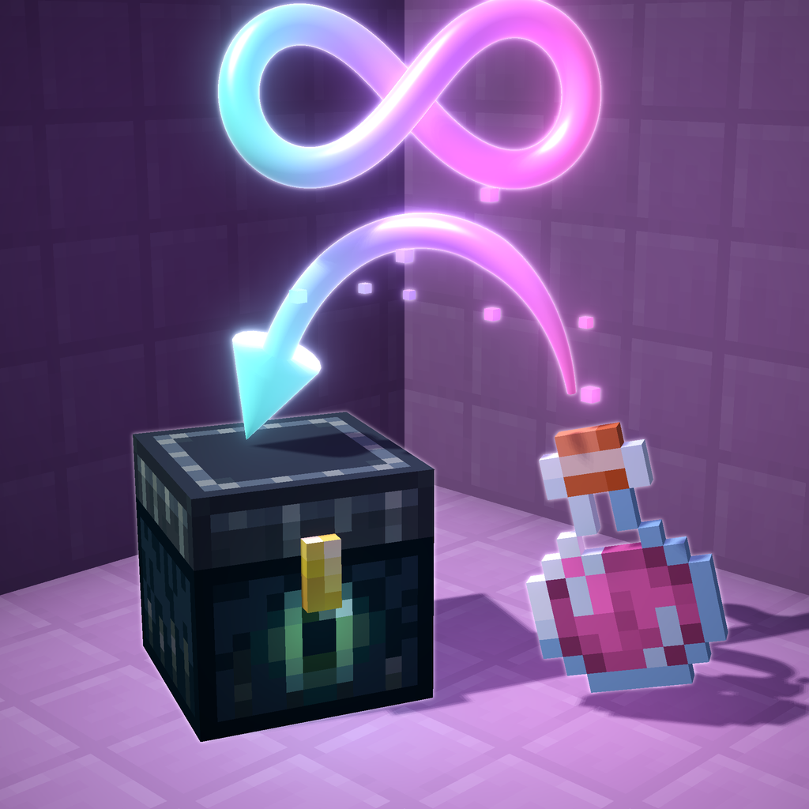

#  Ender Brews

[](https://modrinth.com/project/ender-brews)
[](https://www.curseforge.com/minecraft/mc-mods/ender-brews)
[](https://modrinth.com/project/ender-brews/versions)
[](https://modrinth.com/project/ender-brews/versions)
[](https://github.com/auuruum/Ender-Brews)
[](LICENSE)

Put 8 potions of the same kind in your Ender Chest and that effect becomes endless. Take them out and it's gone.

<p align="center">
  <a href="https://youtu.be/_1pOw55mNeg"></a>
</p>

<p align="center">
  <a href="https://modrinth.com/project/ender-brews"></a>
  &nbsp;
  <a href="https://www.curseforge.com/minecraft/mc-mods/ender-brews"></a>
</p>

## 🧪 How it works

- Only the Ender Chest counts (shulker boxes inside it too).
- Instant effects never become endless. Harmful ones don't either, unless you enable `allow_harmful_effects`.
- A stronger potion stacks on top: Strength II over endless Strength I gives II, then I comes back.
- Milk and totems can't remove endless effects.
- `/enderbrews` lists your effects. Click one to pause it.

## 📥 Install

One jar for every supported mod loader and plugin server. Pick the jar for your Minecraft version from the downloads.

It only has to be on the server. Vanilla clients can join. Installing it on the client as well adds potion tooltips (`Strength: 5/8 in Ender Chest`), live-updating chat list and a pause-all key.

## ⚙️ Config

`config/enderbrews.toml` (plugin: `plugins/EnderBrews/enderbrews.toml`). Every option is commented in the file. Reload with `/enderbrews reload` (permission `enderbrews.reload`).

## Building

This branch is the Minecraft 1.21.x line (1.21 – 1.21.11); the 26.x line lives on `port/26.3`. Needs Java 21.
Each jar covers a range of releases and runs on Fabric, Quilt, NeoForge, Forge and Paper/Spigot:

| Jar | Minecraft |
| --- | --- |
| `EnderBrews-<version>+mc1.21-1.21.1.jar` | 1.21, 1.21.1 |
| `EnderBrews-<version>+mc1.21.2-1.21.4.jar` | 1.21.2, 1.21.3, 1.21.4 |
| `EnderBrews-<version>+mc1.21.5.jar` | 1.21.5 |
| `EnderBrews-<version>+mc1.21.6-1.21.8.jar` | 1.21.6, 1.21.7, 1.21.8 |
| `EnderBrews-<version>+mc1.21.9-1.21.10.jar` | 1.21.9, 1.21.10 |
| `EnderBrews-<version>+mc1.21.11.jar` | 1.21.11 |

```bash
./gradlew build -Ptarget=1.21.1
```

builds one jar into `build/libs/` (targets are the files in `versions/`). `./build-all.ps1` builds all of them into
`build/release/`. Code that differs between releases is picked with `//#if >=1.21.6` lines, see
[Preprocessor.groovy](buildSrc/src/main/groovy/Preprocessor.groovy).
Design notes: [docs/DESIGN.md](docs/DESIGN.md). Real-server tests: [tools/ingame-test](tools/ingame-test/README.md).

## License

[MIT](LICENSE)
